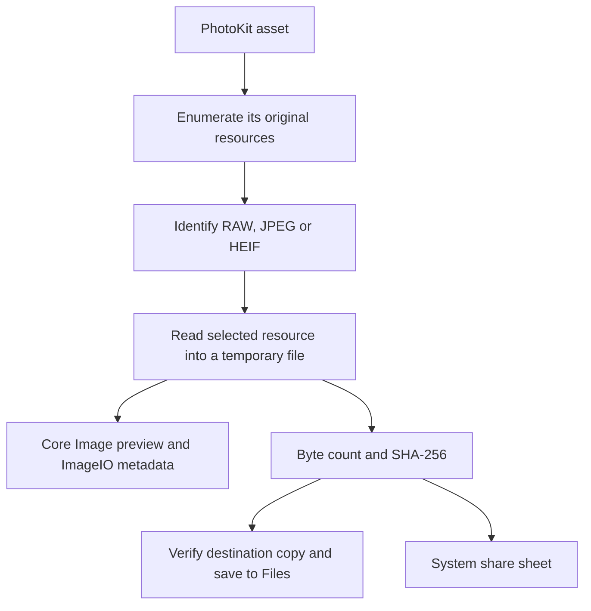
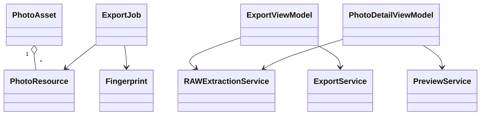

<p align="center">
  
</p>
<h1 align="center">RawBridge</h1>
<p align="center"><strong>Extract camera RAW originals from Apple Photos</strong></p>
<p align="center">
  
  
  
  
  
</p>
<p align="center"><a href="README.md">English</a> · <a href="README.zh-CN.md">简体中文</a></p>

A Nikon exposure shot in RAW + JPEG can appear as a single photo on an iPad. If Photos retained both originals, RawBridge lets you save the NEF under its original filename, save the JPEG, or export the two files side by side. The original image bytes and embedded EXIF travel together.

[**Version history**](CHANGELOG.md)

**Current milestone** · A PhotoKit integration test created one asset from a public Nikon NEF and a JPEG generated from it. The extracted NEF matched the 10,656,312-byte input by SHA-256. Version 0.4.0 (build 7) passed nine tests on a physical iPad mini, including collapsing and reopening a format group. Importing from a Nikon camera over USB and comparing the exported NEF against the camera card is the next hardware check. [Build and test evidence](docs/validation.md)

On iOS and iPadOS 26 or later, the scan uses the time each photo was added to Photos. On earlier versions it uses the system’s Recently Added album, which may contain fewer than 100 photos. After upgrading from a full-library index, tap Refresh once to build the new list.

## Extract your first NEF

1. Open `RawBridge.xcodeproj` in Xcode, select the **RawBridge** scheme and run on an iPhone or iPad. Grant access to a photo that has a RAW original. Tap **Refresh library** to group the 100 most recently added photos you can access. A JPEG + RAW pair counts as one photo.
2. Find the photo by its RAW filename and extension (such as `.NEF`) in the **JPEG + NEF** group for a Nikon pair. Open it to see each original filename and format. For a Nikon pair, look for a `.NEF` entry alongside the `.JPG`.
3. Tap **Export → RAW → Save to Files** and choose a folder. Choose **RAW + JPEG** to save both originals. The system picker offers local storage, iCloud Drive and mounted drives according to what is available on the device.
4. To check a real import, open **Settings → Verify integrity**. Select the original on the camera card, then the file in the destination folder. RawBridge compares their byte counts and SHA-256 digests. [On-device test procedure](docs/device-tests.md)

## Library and export capabilities

| Area | What you can do |
| --- | --- |
| Library | Open the last refreshed list, or use the refresh button or pull down to find new photos. Only formats present in the filtered list appear. Paired originals come first (e.g. **JPEG + NEF**), followed by standalone RAW types, JPEG, HEIC/HEIF and the remaining named formats in alphabetical order. Tap a group heading to expand or collapse its photos. Filter by format or camera brand, and reverse the import order within each group. **Read camera brands** fills in brands from available local metadata for formats such as DNG and JPEG. **Select all** selects the filtered results. |
| Detail | Inspect each resource's filename, role, UTI and size when available. Switch between originals to see their previews and available camera, lens and exposure data. A RAW decoder failure leaves extraction available. |
| Batch export | Select RAW, JPEG or both. The paired mode requires both originals and reports how many photos lack the requested resources. A HEIF + RAW asset supports RAW-only export. |
| Progress and retry | Follow the active file and completed count, cancel a batch or retry unfinished files. For duplicate filenames, keep both with a numbered suffix or report the conflict. |
| iCloud and sharing | Downloads are off by default. Enable **Allow iCloud downloads** for cloud-only originals and follow progress when Photos reports it. Tap **Share** once to open the system share sheet immediately. Each selected original is delivered with its filename after extraction and checksum verification. |

## Architecture



<details>
<summary>Components and data model</summary>



One `PhotoAsset` can contain a JPEG and a RAW resource. Each `ExportJob` tracks one resource, and a successful job records its fingerprint. Retrying a batch picks up jobs that still lack a receipt.

</details>

<details>
<summary>PhotoKit and file integrity</summary>

`PHAssetResource.assetResources(for:)` enumerates the resources behind each photo. The original still-image roles are `.photo` and `.alternatePhoto`. Either can hold RAW. The detector checks `UTType.rawImage` first. When type information is generic, it uses the filename extension and checks the file signature during extraction. Explicit JPEG and HEIF types take precedence over a misleading filename.

A single local file uses `PHAssetResourceManager.writeData`. Batches and network-enabled requests use cancellable `requestData` and stream chunks to disk. When saving to Files, `NSFileCoordinator` coordinates the write. RawBridge reads the staged destination copy in 1 MiB chunks, checks its byte count and digest, then moves it to its final name. Cancelling a single local write can take until PhotoKit finishes that write.

On iOS 26 and later the resource type comes from `contentType`. On iOS 27 and later PhotoKit exposes `filename` and optional `dataSize`. Earlier versions use `originalFilename` and `uniformTypeIdentifier`. RawBridge can measure the byte count after reading an original when Photos omits its size.

</details>

## Stack and source tree

SwiftUI and Swift Concurrency drive the interface and background work. PhotoKit supplies the original files, Uniform Type Identifiers classifies resources, Core Image renders RAW previews, ImageIO reads metadata and CryptoKit computes SHA-256.

```text
RawBridge.xcodeproj/                 Xcode project and shared scheme
App/                                App entry point and permissions
Views/ · ViewModels/                Library, photo detail, export and settings
Models/                             Assets, resources and export jobs
Services/ · Utilities/              Resource access, previews, export and integrity
Resources/                          App icon and English / Simplified Chinese strings
RawBridgeTests/ · RawBridgeUITests/  PhotoKit integration, resource safety and UI tests
Scripts/ · docs/                    Sample test runner and device validation notes
```

## Camera formats and compatibility

| Camera family | Recognized formats | Validation so far |
| --- | --- | --- |
| Nikon | NEF, NRW | A public NEF was extracted alone and from a JPEG + NEF pair in PhotoKit. NRW is covered by the format-detection test. |
| Apple | DNG / ProRAW | A public iPhone 12 Pro DNG was identified from its metadata and extracted with a matching digest. Other DNGs remain eligible for RAW extraction. |
| Canon · Sony · Fujifilm | CR2, CR3 · ARW · RAF | Filename fallback covered by tests. Camera originals await field checks. |
| Panasonic · Leica · OM SYSTEM · Pentax | RW2 · DNG, RWL · ORF · PEF | Filename fallback covered by tests. Camera originals await field checks. |

## Hardware validation roadmap

1. **USB import** · Import a RAW + JPEG exposure through Photos on an iPad. Record the camera model, firmware and resources Photos exposes, then compare both exported files with the card originals.
2. **Storage and access** · Exercise cloud-only originals, changes to limited access, a full or disconnected USB drive and files saved by a share recipient.
3. **Scale and compatibility** · Measure large-library scans and concurrent iPad windows, and try an original the device cannot preview. [Field checklist](docs/device-tests.md)

## Build and test

The checked-in project was built with Xcode 27.2 and targets iOS and iPadOS 17.0 or later. Choose your team under **Signing & Capabilities** for a physical device. XcodeGen 2.45.3 is optional for regenerating the project after editing `project.yml`.

Press **⌘U** for the test suite. For the PhotoKit integration tests, use a development simulator. The script grants Photos access to RawBridge in that simulator and leaves the test assets there for inspection.

```sh
xcrun simctl list devices available
# Replace SIMULATOR_UDID with the ID of your development simulator.
./Scripts/test-nikon-pair.sh SIMULATOR_UDID
```

The script verifies the downloaded Nikon sample against a pinned SHA-256 digest and generates its companion JPEG. To include the Apple DNG case, pass the downloaded DNG's local path as the second argument. Tests with missing fixtures are reported as skipped. [Nikon sample](https://github.com/letmaik/rawpy/tree/main/test) · [Apple DNG sample](https://raw.pixls.us/getfile.php/4264/nice/Apple%20-%20iPhone%2012%20Pro%20-%208bit%20%284%3A3%29.DNG)

## API references

Apple documents how one photo asset can own multiple underlying files and how Photos delivers each resource's bytes. [PhotoKit resources](https://developer.apple.com/documentation/photos/phassetresource) · [Resource manager](https://developer.apple.com/documentation/photos/phassetresourcemanager) · [RAW type](https://developer.apple.com/documentation/uniformtypeidentifiers/uttype-swift.struct/rawimage) · [iCloud network access](https://developer.apple.com/documentation/photos/phassetresourcerequestoptions/isnetworkaccessallowed) · [Apple ProRAW](https://developer.apple.com/videos/play/wwdc2021/10160/)

## Privacy

RawBridge reads the assets you authorize and processes photos and metadata on your device. Photos access uses the `.readWrite` authorization level, and the app leaves library originals untouched. Preferences and a protected cache of the last refreshed list (asset IDs, filenames, format groups and RAW extensions) are stored locally. The cache is checked against the photos you can access before display. The app has no account, analytics SDK or third-party backend. Photos downloads originals from iCloud only when enabled. You choose where files go when saving or sharing.

## Contributing

For a camera compatibility report, include the camera model, firmware, OS version, import method, resource roles and UTIs. Include byte counts and whether the SHA-256 digests matched for both the card and the exported files. A report can be reproduced without publishing personal photos. [Device test record](docs/device-tests.md)

## License

RawBridge is released under the MIT license. Its app icon draws inspiration from PixelBridge. [License and attribution](LICENSE)
