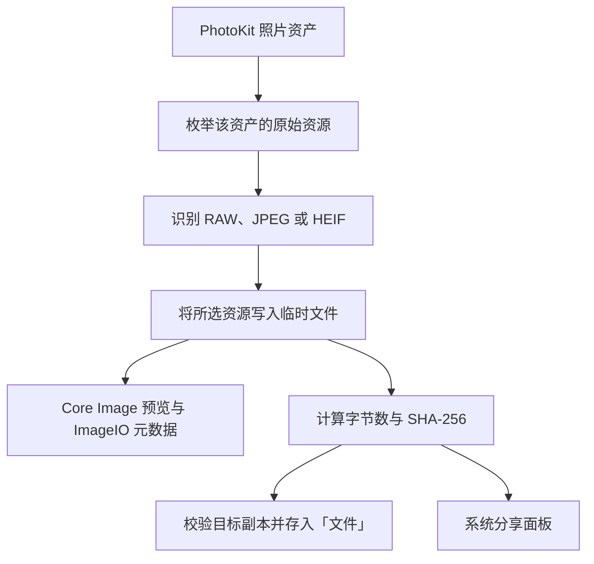
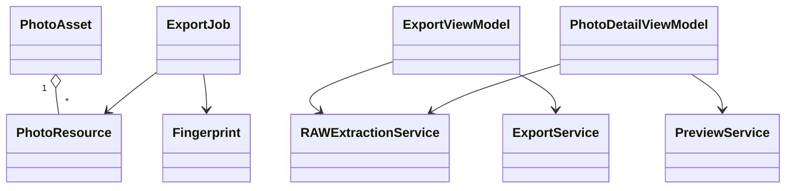

<p align="center">
  
</p>
<h1 align="center">RawBridge</h1>
<p align="center"><strong>从 Apple「照片」中单独提取相机 RAW 原片</strong></p>
<p align="center">
  
  
  
  
  
</p>
<p align="center"><a href="README.md">English</a> · <a href="README.zh-CN.md">简体中文</a></p>

尼康以 RAW + JPEG 拍摄的一次曝光，在 iPad 的「照片」里可能只显示为一张照片。只要图库保留了两份原始资源，RawBridge 就能按原文件名取出 NEF，单独保存 JPEG，或将两个文件分别存入同一目录。原片中的图像数据和 EXIF 会一并保留。

[**版本记录**](CHANGELOG.md)

**当前进度** · PhotoKit 集成测试把一份公开的尼康 NEF 和由它生成的 JPEG 注册为同一照片资产。导出的 NEF 与输入样本均为 10,656,312 字节，SHA-256 一致。0.2.2（构建 4）在 iPhone 和 iPad 模拟器上各通过 14 项测试。下一项实机验收是通过 USB 将照片导入 iPad，再把导出结果与相机卡上的原片比对。[构建与测试记录](docs/validation.md)

## 提取第一张 NEF

1. 在 Xcode 打开 `RawBridge.xcodeproj`，选择 **RawBridge** scheme，在 iPhone 或 iPad 上运行。首次启动时，允许访问一张含有 RAW 原片的照片，然后点 **刷新图库**。
2. 在 **JPEG + RAW** 分组中按 RAW 文件名和后缀（如 `.NEF`）找到照片。打开详情可分别查看 JPEG 和 RAW 的原始文件名与格式。对于尼康配对照片，可在此确认同一项里同时有 `.NEF` 和 `.JPG`。
3. 点 **导出 → RAW → 存储到“文件”**，选择目标文件夹。要同时保留两份原片，选 **RAW + JPEG**。系统目录选择器会显示设备上可用的位置，包括本地目录、iCloud Drive 和已挂载的外接盘。
4. 核验实拍文件时，打开 **设置 → 校验文件完整性**，依次选择相机卡原片和目标目录中的导出文件，比较两者的字节数和 SHA-256。[实机测试步骤](docs/device-tests.md)

## 图库与导出能力

| 模块 | 可以做什么 |
| --- | --- |
| 图库 | 打开时恢复上次刷新的列表。点刷新按钮或下拉刷新可发现新照片。图库分为 JPEG + RAW、仅 RAW、HEIF + RAW、Apple ProRAW、仅 JPEG、仅 HEIF 和其他格式，各组内按拍摄时间排序，也可单独选择格式或相机品牌。JPEG、DNG 等通用格式可以通过 **读取本地照片的相机品牌** 补充索引。**全选** 作用于当前筛选结果。 |
| 详情 | 查看每个资源的文件名、角色、UTI 和已知大小。切换原片预览可查看其中记录的相机、镜头与曝光参数。即使设备无法解码 RAW，仍可提取文件。 |
| 批量导出 | 提取 RAW、JPEG 或两者。双格式模式处理同时具备两份原片的照片，并显示缺少所选资源的照片数。HEIF + RAW 照片可单独提取 RAW。 |
| 进度与重试 | 查看当前文件与已完成数量，取消批次，或重试尚未完成的文件。遇到同名文件时，可加序号保留两份，也可报告冲突。 |
| iCloud 与分享 | 下载默认关闭。对仅在云端的原片，开启 **允许从 iCloud 下载原片** 后可查看系统提供的进度。点一次 **分享** 即可打开系统分享面板。每份所选原件提取并校验后，按原文件名交给接收方。 |

## 系统架构



<details>
<summary>组件关系与数据模型</summary>



一个 `PhotoAsset` 可以同时包含 JPEG 和 RAW 两个 `PhotoResource`。每个 `ExportJob` 对应一个资源，成功后记录文件摘要。重试时，队列继续处理尚无成功记录的文件。

</details>

<details>
<summary>PhotoKit 读取与文件校验</summary>

`PHAssetResource.assetResources(for:)` 枚举每张照片的底层资源。原始静态照片的角色为 `.photo` 或 `.alternatePhoto`，两种角色都可能是 RAW。应用优先判断资源是否符合 `UTType.rawImage`。类型信息宽泛时会参考扩展名，并在提取时检查文件头。明确的 JPEG 或 HEIF 类型优先于文件名。

本地单文件导出使用 `PHAssetResourceManager.writeData`。批量任务和允许网络访问的请求使用可取消的 `requestData`，分块写入磁盘。保存到「文件」时，应用通过 `NSFileCoordinator` 协调写入，以 1 MiB 为单位读取目标位置的临时副本，核对字节数和摘要，再移至最终文件名。取消本地单文件写入时，可能需要等待 PhotoKit 完成当前写入。

iOS 26 起，资源类型取自 `contentType`。iOS 27 起使用 `filename` 及可选的 `dataSize`。旧版本使用 `originalFilename` 和 `uniformTypeIdentifier`。如果图库没有提供大小，应用可在读出原片后显示实际字节数。

</details>

## 技术栈与目录

SwiftUI 和 Swift Concurrency 负责界面与异步任务。PhotoKit 读取原始文件，Uniform Type Identifiers 识别资源类型，Core Image 生成 RAW 预览，ImageIO 读取元数据，CryptoKit 计算 SHA-256。

```text
RawBridge.xcodeproj/                 Xcode 工程与共享 scheme
App/                                应用入口与权限
Views/ · ViewModels/                图库、照片详情、导出与设置
Models/                             照片资产、资源与导出任务
Services/ · Utilities/              资源读取、预览、导出与完整性校验
Resources/                          应用图标与中英文文案
RawBridgeTests/ · RawBridgeUITests/  PhotoKit 集成、资源校验与界面测试
Scripts/ · docs/                    样本测试脚本与实机验证记录
```

## 相机格式与兼容性

| 相机品牌 | 可识别格式 | 当前验证范围 |
| --- | --- | --- |
| Nikon | NEF、NRW | 已从单独的 NEF 资产和 JPEG + NEF 配对资产提取公开样本。NRW 已覆盖扩展名识别测试。 |
| Apple | DNG / ProRAW | 已依据元数据识别一份公开的 iPhone 12 Pro DNG，导出摘要与样本一致。其他 DNG 也可作为 RAW 提取。 |
| Canon · Sony · Fujifilm | CR2、CR3 · ARW · RAF | 已覆盖扩展名识别测试，各机型原片待实测。 |
| Panasonic · Leica · OM SYSTEM · Pentax | RW2 · DNG、RWL · ORF · PEF | 已覆盖扩展名识别测试，各机型原片待实测。 |

## 实机验证路线

1. **USB 导入** · 用 iPad「照片」导入一次 RAW + JPEG 曝光，记录机型、固件和系统保留的资源，再将两个导出文件分别与卡上原件比对。
2. **存储与授权** · 验证仅在 iCloud 的原片、有限访问范围变更、外接盘写满或断开，以及分享接收方实际保存的文件。
3. **大图库与兼容性** · 测量大图库扫描与 iPad 多窗口并发导出，检查设备无法预览的原片是否仍能完整写出。[现场验收清单](docs/device-tests.md)

## 安装、构建与测试

工程已使用 Xcode 27.2 构建，最低部署版本为 iOS / iPadOS 17.0。真机运行时，在 **Signing & Capabilities** 选择自己的开发团队。修改 `project.yml` 后，可用 XcodeGen 2.45.3 重新生成工程。

在 Xcode 按 **⌘U** 运行测试。要复现 PhotoKit 集成测试，请使用开发用模拟器。脚本会向该模拟器里的 RawBridge 授予照片访问权限，测试资产将留在模拟器中，便于打开查看。

```sh
xcrun simctl list devices available
# 将 SIMULATOR_UDID 替换为开发用模拟器的 ID
./Scripts/test-nikon-pair.sh SIMULATOR_UDID
```

脚本会核对下载的尼康样本与预设的 SHA-256，再生成配对 JPEG。要同时运行 Apple DNG 用例，可把下载好的 DNG 的本地路径作为第二个参数。缺少样本的用例会标为跳过。[尼康样本](https://github.com/letmaik/rawpy/tree/main/test) · [Apple DNG 样本](https://raw.pixls.us/getfile.php/4264/nice/Apple%20-%20iPhone%2012%20Pro%20-%208bit%20%284%3A3%29.DNG)

## API 参考

Apple 的文档说明了一项照片资产如何保留多个底层文件，以及 PhotoKit 如何按资源读取原始字节。[照片资源模型](https://developer.apple.com/documentation/photos/phassetresource) · [资源读取接口](https://developer.apple.com/documentation/photos/phassetresourcemanager) · [RAW 类型](https://developer.apple.com/documentation/uniformtypeidentifiers/uttype-swift.struct/rawimage) · [iCloud 下载选项](https://developer.apple.com/documentation/photos/phassetresourcerequestoptions/isnetworkaccessallowed) · [Apple ProRAW](https://developer.apple.com/videos/play/wwdc2021/10160/)

## 隐私

RawBridge 只读取用户授权的照片，在设备上处理图像与元数据。应用通过 PhotoKit 的 `.readWrite` 级别取得读取权限，图库原件始终保留。偏好设置和上次刷新生成的列表缓存在本机。列表仅记载照片标识、文件名、格式分组和 RAW 扩展名，显示前会核对当前可访问的照片。应用无需账号，也没有统计 SDK 或第三方后端。开启原片下载后，系统「照片」可从 iCloud 取回资源。保存或分享的目的地由用户选择。

## 贡献指南

提交兼容性记录时，请附相机型号、固件、系统版本、导入方式、资源角色与 UTI，并注明卡上原件及导出文件的字节数和 SHA-256 比对结果。这些信息足以描述问题，无需公开私人照片。[实机记录表](docs/device-tests.md)

## 许可证

RawBridge 采用 MIT 许可证，应用图标参考了 PixelBridge 的设计。[许可证与署名](LICENSE)
